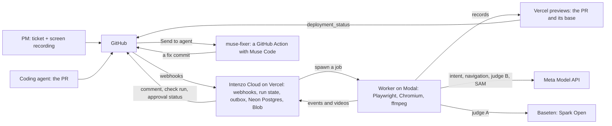

# Intenzo

**Proof your PR did what the ticket asked, on video, before a human opens the diff.**

Intenzo drives a pull request's preview deployment in a real browser, records each acceptance criterion from the linked ticket, judges the recording against that intent with Meta's video models, and posts the verdicts and evidence back to the PR.

Built for the Meta Global AI Developer Hackathon (Indie track, _Push the Frontier_) by [Nilesh Gupta](https://github.com/0xNilesh) and [Sumith Prabhu](https://github.com/sumithprabhu).

## The problem

Coding agents now open pull requests faster than people can review them, and their PRs are usually _almost_ right. The code compiles, its own tests pass and the diff reads well. But the total only updates after a reload, or the free-shipping threshold is off by one.

CI shows that the code runs. Review shows that it reads well. Neither runs the app the way the ticket described it, so nobody can quickly answer the one question that matters before merging: **did it do what we asked?**

## How it works

On every PR that links a ticket, Intenzo:

1. **Reads the intent.** The ticket's text and the PM's narrated screen recording become a short list of acceptance criteria, each with what to do, what to watch and what must be true (Voice Transcribe and Spark 1.3). The criteria are reused by every later PR for the same ticket.
2. **Finds each criterion's trigger** on the PR's preview: Wonder explores the app from an accessibility outline. The path it finds is cached, so later runs replay it.
3. **Records each criterion twice**: on the PR's preview and on the base branch's, each time as a brand-new user from your app's [session hook](docs/hooks.md). Each recording captures exact readings of the watched elements before and after the trigger, a judge video with a time band, and an annotated still.
4. **Judges each recording with two models.** Spark Open and Spark 1.3 get the same bundle, and a pass or fail stands only when both agree and cite the readings. A fail is recorded once more to confirm it. Anything unclear is reported as inconclusive, never guessed.
5. **Reports on the PR**: a comment and a check run with a verdict per criterion, a GIF of each failure (SAM 3.1 outlines visual elements such as a chart slice), and anything the PR changed that no criterion asked for. "Send to agent" hands a failure to a coding agent (muse-fixer, with Muse Code), and the PM approves from the Checks tab.

## Architecture



The Cloud never runs a browser, and the worker never holds GitHub credentials. Every GitHub write goes through an outbox, so a retried webhook or a crashed function never posts twice. The full design, with the reasons behind it, is in [`docs/ARCHITECTURE.md`](docs/ARCHITECTURE.md), and every measured choice is in [`docs/DECISIONS.md`](docs/DECISIONS.md).

## Meta models

| Model                | Where it runs          | What Intenzo uses it for                                                                                                                                 |
| -------------------- | ---------------------- | -------------------------------------------------------------------------------------------------------------------------------------------------------- |
| **Voice Transcribe** | Meta Model API         | the PM's spoken ticket, as text                                                                                                                          |
| **Spark 1.3**        | Meta Model API         | reading the ticket and the PM's video into criteria; mapping criteria to the diff; judge B; pointing at a chart for SAM; classifying unrequested changes |
| **Wonder**           | Meta Model API         | exploring the PR's app to find each criterion's trigger                                                                                                  |
| **Spark Open**       | Baseten (open weights) | judge A, on the same video bundle as judge B                                                                                                             |
| **SAM 3.1**          | Meta Model API         | outlining a visual criterion's object on every frame of its evidence                                                                                     |
| **Muse Code**        | its CLI, in muse-fixer | writing the fix when someone presses "Send to agent"                                                                                                     |

## IntentBench: what the evidence buys

IntentBench (§31) asks whether watching the app matters, or whether reading the diff is enough. Twelve demo-shop branches implement four tickets correctly, almost right (a planted defect), with an unrequested side effect, or broken. Every one of their 42 criteria has a label proven by a scripted Playwright check. Each criterion is recorded once (`pnpm bench:record`), then judged by four arms that see more and more of the evidence (`pnpm bench:judge`):

| Arm | Sees                                       | Right (judgeable) | Wrong passes                | False fails | Cost / PR |
| --- | ------------------------------------------ | ----------------- | --------------------------- | ----------- | --------- |
| A   | the ticket and the diff only               | 100%              | **33%** of failing criteria | 0%          | $0.017    |
| B   | the recording's readings (text)            | 87%               | 0%                          | 0%          | $0.017    |
| C   | readings + 8 stills                        | 96%               | 0%                          | 0%          | $0.035    |
| D   | readings + the video, two judges (Intenzo) | 98% (96–100%)     | 0%                          | 0%          | $0.040    |

**Held out: 8 cases, 28 criteria, 2 repeats.** "Judgeable" leaves out the 5 criteria whose recording failed (a broken build can't be recorded).

- **Reading the diff is enough to spot these defects, but not enough to merge on.** The diff-only arm passed a build whose cart throws on every load in 4 of 6 judgements. Every arm that ran the app stayed inconclusive there, and none passed it.
- **No arm failed a criterion that holds.**
- **Among the arms that watch the app, more evidence is better:** readings 87%, stills 96%, video 98%.
- **The two judges cover each other:** Spark 1.3 alone once passed a planted off-by-one, and the dual rule didn't.

**Small n:** 8 held-out cases on one demo app, seeded by hand. These numbers show the shape of the trade-off, not a general accuracy.

Charts: [`bench/results/rates.png`](bench/results/rates.png) · [`accuracy.png`](bench/results/accuracy.png) · [`cost.png`](bench/results/cost.png). Method and raw results: [`bench/intentbench/README.md`](bench/intentbench/README.md), [`bench/results/judge-heldout.json`](bench/results/judge-heldout.json), DECISIONS 2026-11-01 · IntentBench judged.

## Try it on your machine

`intenzo run --local` runs the whole verify job here, without the Cloud. It runs against [demo-shop](https://github.com/sumithprabhu/demo-shop), the demo app, served twice: its `main` as the base and the almost-right discount-code branch as the PR. With no model keys it costs nothing: it records every criterion in a real browser, and the verdicts are placeholders.

You need Node 24 ([nvm](https://github.com/nvm-sh/nvm)), ffmpeg, git and openssl.

```bash
git clone https://github.com/0xNilesh/intenzo && cd intenzo
nvm install && nvm use && corepack enable pnpm && pnpm install
pnpm --filter @intenzo/core exec playwright install chromium
SECRET=$(openssl rand -hex 32)
echo "DEMO_SHOP_HOOK_SECRET=$SECRET" >> .env   # the session hook's secret (docs/hooks.md)

# demo-shop twice: main (the base) and pr/discount-almost-right (the PR)
git clone https://github.com/sumithprabhu/demo-shop ../demo-shop
git -C ../demo-shop worktree add ../demo-shop-pr pr/discount-almost-right
for app in ../demo-shop ../demo-shop-pr; do
  (cd "$app" && pnpm install && echo "INTENZO_HOOK_SECRET=$SECRET" > .env.local && pnpm build)
done
(cd ../demo-shop && pnpm start -p 3000 &) ; (cd ../demo-shop-pr && pnpm start -p 3001 &)

pnpm intenzo run --local --pr http://localhost:3001 --base http://localhost:3000 --criteria fixtures/criteria
```

It prints each criterion and its verdict, and leaves the takes' videos in `out/runs/`.

- **Real verdicts:** add `META_API_KEY` and `BASETEN_API_KEY` to `.env`. The two judges then decide, at about $0.10 a run.
- **Criteria from the ticket:** `--ticket fixtures/tickets/5.md` instead of `--criteria`, read by Spark 1.3.
- **Exploring:** `--explore` lets Wonder find the paths instead of using the hand-written ones.

More commands are in [`apps/worker/README.md`](apps/worker/README.md); the tests and checks are in [`CONTRIBUTING.md`](CONTRIBUTING.md).

## Use it on a repo

Intenzo is a GitHub App, with the Cloud on Vercel and the worker on Modal ([`apps/cloud/README.md`](apps/cloud/README.md)). A repo needs:

- **Preview deployments** that send GitHub `deployment_status` events: Vercel does, once its project setting is on.
- **A [session hook](docs/hooks.md)**, about 15 lines, so every recording starts as a new user.
- **A `.intenzo.yml`** on its default branch: the hook's path, where the app starts, the PM approvers, and what the navigator may never click ([ARCHITECTURE §10](docs/ARCHITECTURE.md#10-configuration-intenzoyml)).
- **Tickets linked from PRs** ("Closes #5"), as text, or as the PM's screen recording.

## Honest limits

- **UI behaviour only.** Intenzo checks what a user can see and do in the browser. A criterion about an API or a background job is reported as not verifiable.
- **No session hook, no verdict.** Without isolation every verdict is capped at inconclusive (§21.1).
- **Inconclusive over wrong.** When the two judges disagree, or a judge's citation doesn't match the readings, the criterion is inconclusive. No IntentBench arm failed a criterion that holds; the price is some inconclusives.
- **Public repos only, for now.** The App can't download a private repo's issue attachments, so the PM's video needs a public repo.
- **Cost and time:** $0.07–0.21 and 1–3 minutes a run, measured at the P4 and P5 gates (§27). Exploring a new path costs about $0.03 a criterion, and up to $0.26 when the trigger can't be found.
- **A small benchmark:** 8 held-out cases on one demo app, seeded by hand (above).
- **Not built yet:** the check run's "Re-run" button, `agent_trigger: auto`, and teams as approvers. The preview preflight can't yet tell a missing Vercel bypass from a working preview: both answer with a redirect.

## Built during the hackathon

Everything here was built from Oct 29 to Nov 4, 2026, in order, one roadmap task and one pull request at a time ([`docs/ROADMAP.md`](docs/ROADMAP.md)):

| Phase | What                                                                                                                                       |
| ----- | ------------------------------------------------------------------------------------------------------------------------------------------ |
| P0    | Probes of every Meta model's real API, a go/no-go for video judging, the GitHub App, demo-shop with seeded branches, the PM's video ticket |
| P1    | The evidence engine: lanes, a canonical clock, readings, judge and human videos, annotated stills                                          |
| P2    | The hosted skeleton: webhooks, the run state machine, the outbox, the Modal worker, reports                                                |
| P3    | The navigator: Wonder's explore loop, the path cache and replay                                                                            |
| P4    | Intent from text and video, coverage, the judge bundle and its rules, two live judges, the streaming comment                               |
| P5    | Evidence GIFs, SAM 3.1 on the chart, muse-fixer and "Send to agent", PM approval, unrequested-change detection, the billing meter          |
| P6    | IntentBench: 12 cases, 42 labelled criteria, record once, judge many, the analysis                                                         |
| P7    | Failure injection, the preview preflight, demo scripts, these docs                                                                         |

Each choice that rests on a measurement has an entry in [`docs/DECISIONS.md`](docs/DECISIONS.md).

## Repository

| Path                                     | What                                                                            |
| ---------------------------------------- | ------------------------------------------------------------------------------- |
| [`packages/core`](packages/core)         | schemas, config, models, prompts, browser recording, navigator, judges, reports |
| [`apps/worker`](apps/worker)             | the job runner (Modal) and the local `intenzo` CLI                              |
| [`apps/cloud`](apps/cloud)               | the Next.js Cloud: webhooks, run state, outbox, report pages                    |
| [`agents/muse-fixer`](agents/muse-fixer) | the reference fixer agent, a GitHub Action                                      |
| [`modal`](modal)                         | the Modal app and its shim                                                      |
| [`bench`](bench)                         | IntentBench and its analysis                                                    |
| [`scripts`](scripts)                     | probes, gates, demo scripts, docs checks                                        |
| [`docs`](docs)                           | architecture, decisions, roadmap, the session hook                              |

[`CONTRIBUTING.md`](CONTRIBUTING.md) is the policy for humans and AI agents alike, and [`AGENTS.md`](AGENTS.md) is the agents' playbook.

## License

Apache License 2.0. See [LICENSE](LICENSE) and [NOTICE](NOTICE).
